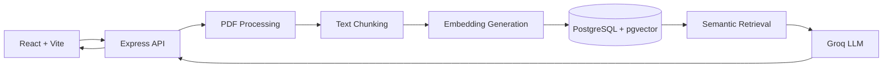

# Paplet

**A RAG-powered research paper assistant for contextual question answering with source citations.**

## Architecture

## Tech Stack

| Component | Technology |
|---|---|
| Frontend | React, TypeScript, Vite |
| Backend | Node.js, Express, TypeScript |
| Validation | Zod |
| Database | Supabase PostgreSQL |
| Vector Search | pgvector |
| Embeddings | Sentence Transformers |
| LLM | Groq |

## Core Workflow

1. Upload research papers.
2. Extract and chunk document text.
3. Generate and store embeddings.
4. Retrieve relevant passages using vector similarity.
5. Generate context-grounded answers with citations.

