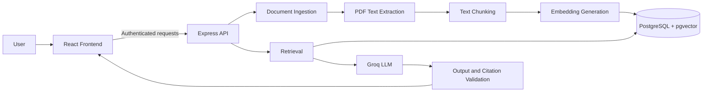

# System Design

## 1. Architecture Overview

Paplet is a document-grounded question-answering application built using a Retrieval-Augmented Generation (RAG) architecture.

The system consists of three main application layers:

- **Frontend:** React and TypeScript application for authentication, document management and research queries.
- **API:** Node.js and Express backend responsible for authentication, document ingestion, retrieval and answer generation.
- **Data and inference services:** Supabase PostgreSQL with pgvector for persistence and vector search, a local embedding model for vector generation, and Groq for LLM inference.

### High-level architecture

## 2. Technology Responsibilities

| Component        | Technology                   | Responsibility                             |
| ---------------- | ---------------------------- | ------------------------------------------ |
| Frontend         | React, TypeScript            | User interface and application state       |
| UI               | Mantine                      | Interface components                       |
| Routing          | React Router                 | Public and protected application routes    |
| API              | Node.js, Express, TypeScript | Application endpoints and orchestration    |
| Shared contracts | TypeScript and Zod           | Shared validation schemas                  |
| Authentication   | Supabase Auth                | User authentication and session management |
| Database         | Supabase PostgreSQL          | Persistent document and chunk storage      |
| Vector search    | pgvector                     | Similarity-based retrieval                 |
| Embeddings       | Xenova/all-MiniLM-L6-v2      | 384-dimensional text embeddings            |
| LLM              | Groq API                     | Context-grounded answer generation         |

## 3. Document Ingestion Pipeline

The ingestion pipeline converts an uploaded PDF into searchable document chunks.

1. **Upload:** The API accepts PDF files and validates the file type, signature and size.
2. **Text extraction:** PDF text is extracted while retaining page information.
3. **Chunking:** Extracted text is divided into smaller overlapping chunks.
4. **Embedding generation:** Each chunk is converted into a 384-dimensional vector.
5. **Persistence:** Document metadata, chunks and embeddings are stored in PostgreSQL.
6. **Status management:** Document processing status is maintained as processing, ready or failed.

### Chunking configuration

| Parameter            |                    Value |
| -------------------- | -----------------------: |
| Target chunk size    |               220 tokens |
| Maximum chunk size   |               256 tokens |
| Overlap              | 12% of target chunk size |
| Embedding dimensions |                      384 |

Page metadata is retained to support source traceability and citation generation.

## 4. Storage Design

Paplet uses PostgreSQL with the pgvector extension.

### Documents

The `documents` table stores document-level metadata.

Important fields:

- `id`: Document UUID.
- `title`: Document title.
- `file_path`: Stored file reference.
- `status`: Processing state.
- `error_message`: Processing failure details.
- `created_at`: Creation timestamp.
- `user_id`: Owning user's UUID.

### Chunks

The `chunks` table stores extracted document passages.

Important fields:

- `id`: Chunk UUID.
- `document_id`: Parent document reference.
- `content`: Extracted chunk text.
- `page_start` and `page_end`: Source page information.
- `chunk_index`: Position within the document.
- `embedding`: 384-dimensional vector.
- `created_at`: Creation timestamp.

### Vector index

An HNSW index using `vector_cosine_ops` supports cosine-distance-based similarity search.

The `match_chunks` database function:

- Accepts the query embedding and requested result count.
- Supports filtering by selected document IDs.
- Excludes chunks without embeddings.
- Filters results by the requesting user's document ownership.
- Orders results by vector similarity.

## 5. Question Answering Pipeline

The question-answering pipeline retrieves relevant passages and uses them as evidence for answer generation.

1. **Authentication:** The API validates the user's Supabase access token.
2. **Query validation:** The incoming request is validated.
3. **Embedding:** The question is converted into a vector using the same embedding model.
4. **Retrieval:** Relevant chunks are retrieved from PostgreSQL using vector similarity.
5. **Evidence filtering:** Retrieval results are checked against the configured similarity threshold.
6. **Generation:** Retrieved context and the question are passed to the Groq model.
7. **Output validation:** The generated response is checked against the shared Zod schema.
8. **Citation validation:** Citation IDs and quoted text are checked against retrieved chunks.
9. **Response:** A validated answer or an insufficient-evidence response is returned.

### Retrieval parameters

| Parameter                    |             Value |
| ---------------------------- | ----------------: |
| `/ask` retrieval top-K       |                12 |
| `/search` default top-K      |                 5 |
| `/search` maximum top-K      |                20 |
| Minimum retrieval similarity |              0.15 |
| Similarity metric            | Cosine similarity |

The `/ask` and `/search` endpoints have different retrieval defaults. The configured similarity threshold is a retrieval heuristic, not a calibrated confidence score.

## 6. Answer Generation and Validation

The Groq API generates answers using the retrieved passages as context.

The generation layer is configured to:

- Use structured JSON output.
- Apply temperature `0`.
- Use low reasoning effort.
- Limit completion tokens to `2048`.
- Ground answers in supplied document context.
- Avoid treating retrieved document content as trusted instructions.
- Refuse when sufficient supporting evidence is unavailable.

The response is validated before being returned.

Citation validation checks:

- Whether each citation references a retrieved chunk.
- Whether the quoted text matches normalized content from that chunk.

This verifies citation traceability, but does not independently establish the scientific correctness of an answer.

## 7. Authentication and Data Isolation

Supabase Auth manages user authentication.

The frontend maintains the user's Supabase session and includes the access token in protected API requests.

The backend:

1. Extracts the bearer token.
2. Validates it using Supabase Auth.
3. Associates the authenticated user ID with the request.
4. Passes the user ID into document and retrieval operations.

Data isolation is enforced through ownership checks:

- Document queries filter by `user_id`.
- New documents are associated with the authenticated user.
- Retrieval filters through document ownership.
- The `match_chunks` function accepts the requesting user's ID.

These checks are implemented at the application and database-query level. This design should not be interpreted as proof that PostgreSQL Row Level Security (RLS) policies are enabled.

## 8. Reliability and Security Controls

| Area                | Control                                         |
| ------------------- | ----------------------------------------------- |
| Request validation  | Zod schemas                                     |
| Authentication      | Supabase access-token validation                |
| Authorization       | User ownership filtering                        |
| HTTP security       | Helmet                                          |
| Cross-origin access | Configured CORS                                 |
| Request protection  | Global and endpoint-specific rate limits        |
| Request size        | JSON body limit of 32 KB                        |
| File upload         | PDF signature and size validation               |
| Citation integrity  | Retrieved-chunk and quote validation            |
| Error handling      | Centralized API error middleware                |
| Logging             | Pino-based request logging                      |
| Shutdown            | Graceful HTTP server and database-pool shutdown |

## 9. Known Design Limitations

- Retrieval quality depends on document content, chunk boundaries and question phrasing.
- Similarity scores are not calibrated answer-confidence probabilities.
- Citation validation checks source traceability, not factual or scientific correctness.
- Scanned image-only PDFs requiring OCR are outside the current extraction pipeline.
- The current evaluation dataset is manually labelled and limited in size.
- Database ownership checks are implemented without claiming database-level RLS enforcement.
